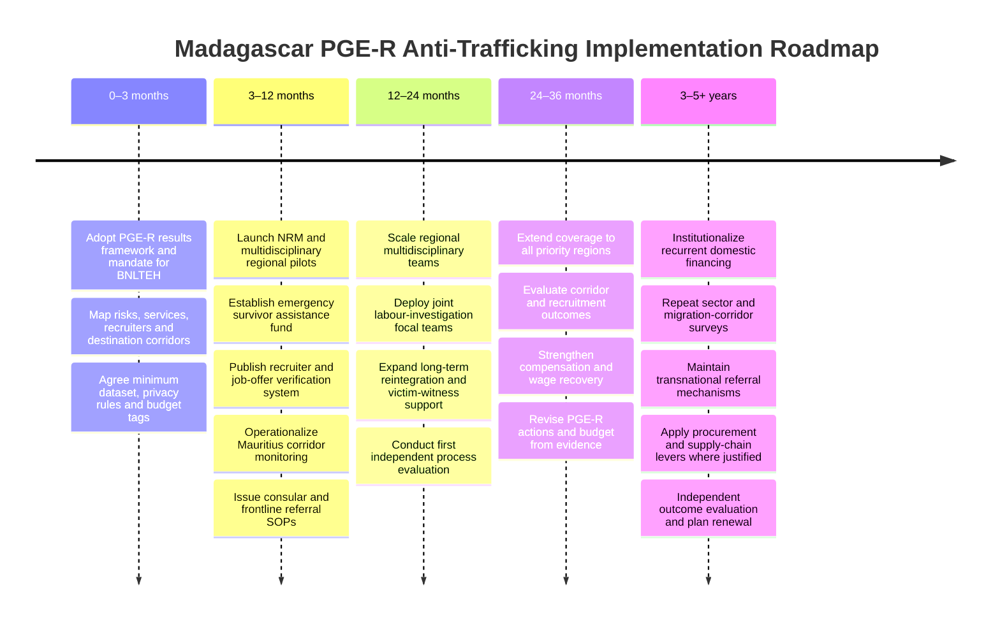
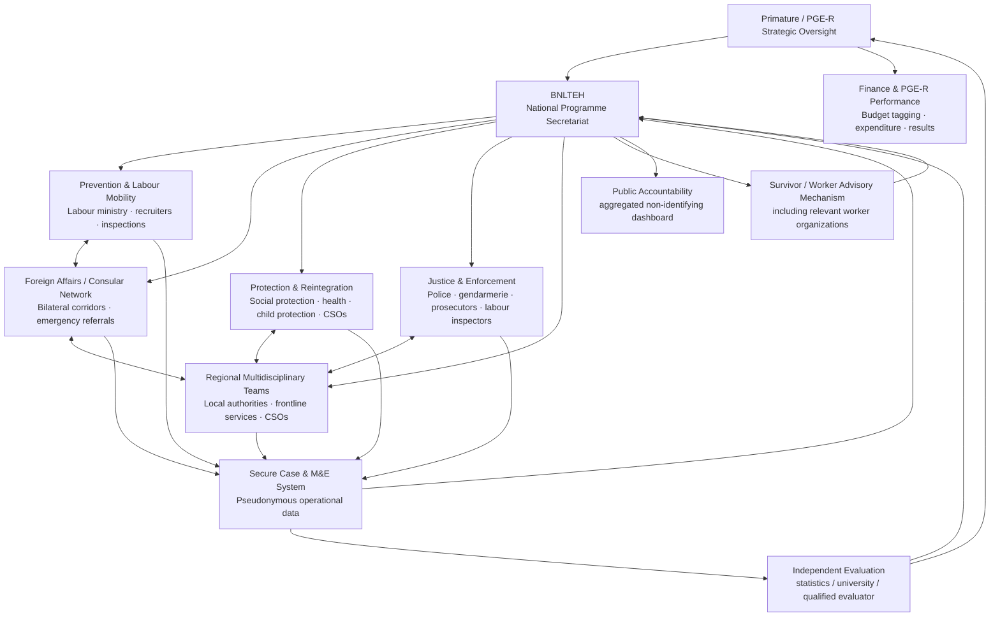

# Integrated Anti-Trafficking Policy for Madagascar: Historical Lessons and a PGE‑R Implementation Roadmap

## Executive summary

Madagascar’s policy objective is unusually well positioned for an integrated response. On 19 October 2026, the Prime Minister directed that measures to prevent trafficking abroad—particularly trafficking affecting jobseekers—be incorporated into the implementation plan of the *Politique Générale de l’État pour la Refondation* (PGE‑R). The government article identifies three assets already in place: the **Bureau national de lutte contre la traite des êtres humains (BNLTEH)** attached to the Primature; the Ministry responsible for Labour, Employment and the Civil Service as an actor in monitoring labour mobility; and a 2026 labour-mobility agreement with Mauritius coupled with work with Malagasy placement agencies to verify job offers. citeturn24view1

The principal conclusion of this research is that Madagascar should **not create a stand-alone anti-trafficking project beside the PGE‑R**. It should create a **costed, results-based anti-trafficking implementation programme inside it**, with BNLTEH acting as a permanent whole-of-government programme office. Historical experience from the Philippines, Moldova, Georgia, Portugal, Belgium, Brazil and Thailand suggests that the strongest systems combine six functions: political coordination; safe-labour-migration prevention; a national referral mechanism; decentralized survivor services; labour/criminal enforcement; and an integrated monitoring and financing system. citeturn20view3turn21search0turn29search1turn4search1

There is an important evidentiary qualification. **No case examined here provides a clean causal demonstration that a national action plan, by itself, reduced national trafficking prevalence.** Trafficking is hidden, detection intensity changes, definitions and survey methods change, and much anti-trafficking evaluation measures activities—trainings, investigations, victims identified or people assisted—rather than counterfactual impact. The evaluation literature has repeatedly highlighted this problem, and the Thai ILO evaluation explicitly warns that even superficially comparable forced-labour estimates cannot necessarily be compared because methodology and sampling changed. citeturn16search2turn17view1 Consequently, the cases below are termed “successful” where they produced **verifiable improvements in victim assistance, referral, worker protection, enforcement capacity or institutional performance**, rather than treating a fall in detected cases as proof that trafficking fell.

The strongest historical lessons for Madagascar are:

| Finding from comparative evidence | Implication for Madagascar |
|---|---|
| **Central coordination works only when tied to operating agencies, budgets and local delivery.** Georgia’s justice-led council, the Philippine IACAT model and Moldova’s national/local referral architecture all connect national leadership to implementers. citeturn20view3turn21search0turn29search1 | Keep BNLTEH under the Primature, but give it a costed PGE‑R results framework, authority to require quarterly reporting and a permanent technical secretariat. |
| **Assistance must begin when there are reasonable grounds to suspect trafficking, not after conviction.** Moldova’s referral architecture was explicitly designed around victims and potential/presumed victims and decentralized multidisciplinary teams. citeturn29search1 | Establish a National Referral Mechanism (NRM) with a “presumed victim” pathway and rapid referral to social, medical, legal and safe-accommodation services. |
| **Safe migration policy is stronger than migration bans.** The ILO documented that hundreds of young Malagasy women continued leaving for high-risk destinations despite the 2013 restrictions, while SENAMAMA emerged as an important worker-led protection mechanism. citeturn27view0turn28view0 | Regulate and monitor recruitment, job offers, contracts and fees; strengthen bilateral corridors; do not make exit restrictions the principal prevention tool. |
| **Dedicated survivor-service budgets matter.** The Philippine RRPTP assisted 2,024 trafficked persons in 2023, with 1,494 recorded as reintegrated with their families, using a separately tracked programme allotment of ₱24.892 million. citeturn20view2 | Give survivor recovery and reintegration a protected budget line instead of expecting ministries or NGOs to absorb cases without funding. |
| **Labour inspection can be a trafficking intervention.** Brazil’s mobile inspection model integrates labour enforcement with police/prosecutorial tools; Thailand showed measurable improvements in wages and formalization when labour regulation was strengthened, even though severe forced labour persisted. citeturn4search1turn17view1 | Combine recruiter supervision, labour inspection and criminal investigation rather than leaving trafficking solely to police. |
| **Victim counts are not an impact measure.** Madagascar identified 171 victims and referred 33 to care in the latest reporting period, compared with 130 identified and 29 referred previously; such increases may mean better detection rather than more trafficking. citeturn22search1 | Measure referral speed, survivor safety, reintegration, recruitment fees, wage recovery, repeat exploitation and periodic prevalence/risk estimates—not merely “victims identified”. |

**Recommended financing envelope.** For planning purposes—not as a government costing—this report proposes approximately **MGA 8–15 billion for the first 12 months**, **MGA 15–30 billion per year during scale-up**, and **MGA 20–40 billion per year once a nationwide system is established**. These bands would cover new anti-trafficking programme costs, not the ordinary salaries of police, courts, health services or the wider social-protection system. Against the government’s projected **MGA 20,825.6 billion of total public expenditure for 2027**, the suggested ranges are approximately 0.04–0.19 per cent of annual expenditure depending on phase. citeturn24view0 They require bottom-up costing before appropriation.

Timing is favourable. On 19 October 2026 the Primature began a nine-week national investment-policy consultation running through 18 December, emphasizing needs-led, results-oriented public investment and reduced dependence on donor priorities. Two days later the government conducted 2027 budget arbitration. citeturn23view3turn24view0 **The immediate opportunity is therefore to translate the Prime Minister’s anti-trafficking instruction into a budget-tagged PGE‑R programme while the wider planning architecture is still being formed**, subject to Madagascar’s formal budget calendar.

## Madagascar’s policy goal and evidence baseline

The [19 October 2026 Primature article](https://app.primature.gov.mg/article/la-lutte-contre-la-traite-des-personnes-sera-integree-au-plan-de-mise-en-oeuvre-de-la-politique-generale-de-letat-pour-l) is more specific than a generic commitment to “fight trafficking.” It prioritizes **prevention of trafficking abroad involving employment seekers**, calls for strategies to be incorporated into the PGE‑R implementation plan, identifies labour-mobility supervision as an existing government tool, cites the Mauritius agreement as an example, and confirms BNLTEH’s mandate to coordinate prevention and suppression both domestically and internationally. citeturn24view1

That framing points to a policy model broader than criminal enforcement. Recruitment, job verification, migration governance, diplomatic/consular protection, social protection and labour rights become part of anti-trafficking policy alongside police and prosecution. This is consistent with IOM’s characterization of Madagascar as an important labour-migration origin country where weak migration-management frameworks can heighten exposure to exploitation. citeturn22search3

Madagascar also has useful domestic experience on which to build rather than importing an entirely foreign model. The ILO documents the creation in 2019 of **SENAMAMA, Madagascar’s first domestic-workers’ union**, founded by returned migrant domestic workers. By 2021 it had more than 2,000 members in Analamanga, Vakinankaratra and Haute Matsiatra; it participated in labour-code reform and, together with the ILO, supported government repatriation of more than 300 migrant workers from Kuwait, Saudi Arabia and Lebanon during the early COVID-19 period. citeturn27view0turn28view0 This provides an existing platform for survivor-informed policy, pre-departure information, community outreach and post-return support.

The same ILO evidence exposes the limits of a prohibition-based model. Despite a 2013 suspension targeting high-risk migration corridors, the ILO reported that hundreds of young Malagasy women continued to depart each year for domestic work in destinations considered high risk. citeturn28view0 The policy lesson is significant: **when employment demand and household economic pressure remain, constraining formal departure can displace migration toward brokers and irregular channels unless safe legal pathways become more attractive and accessible.**

Administrative trafficking statistics show continuing state activity but are not a prevalence baseline. The 2026 U.S. Trafficking in Persons assessment reports that Madagascar identified **171 victims and referred 33 to care**, compared with 130 identified and 29 referred in the preceding reporting period. citeturn22search1 Earlier reporting identified recurring weaknesses in consistent inter-ministerial data contribution, justice delays and victim-witness support, while older reporting described uneven referral infrastructure. citeturn15search20turn15search6 Those historical weaknesses make **case-management interoperability, regional service coverage and longitudinal survivor outcomes** higher priorities than simply building a new central database.

The PGE‑R environment itself favours this approach. The Primature’s October 2026 public-investment consultation explicitly calls for policies grounded in actual Malagasy needs rather than being determined by available donor financing, while the 2027 budget process emphasizes concrete outcomes, transparency and inter-ministerial collaboration. citeturn23view3turn24view0 Anti-trafficking policy can therefore be framed not as an externally imposed compliance project but as a **labour-market integrity, citizen-protection and public-governance programme**.

## Historical case studies and comparison

The cases were selected because they offer an integrated mechanism rather than a single awareness campaign, and because official, UN/IOM/ILO or Council of Europe evidence documents measurable institutional or victim-related outcomes. A distinction is maintained between **outputs** such as inspections and identifications, **outcomes** such as safe reintegration or wage recovery, and **impact** such as reduced trafficking prevalence. Where a funding figure, causal effect or other requested element could not be substantiated, it is marked **unspecified**.

| Case and timeline | Context and objectives | Governance structure | Key interventions | Funding sources | M&E indicators | Measurable outcomes | Challenges, lessons and Madagascar relevance |
|---|---|---|---|---|---|---|---|
| **Philippines — IACAT, RRPTP and successive national strategic plans**. IACAT dates from the 2003 anti-trafficking framework; the Recovery and Reintegration Program for Trafficked Persons (RRPTP) was launched in 2015; the Fourth National Strategic Action Plan covers 2023–27. citeturn21search0turn21search1turn20view2 | A large migrant-worker origin country facing sex trafficking, labour trafficking and cross-border exploitation. Objectives combine prevention, protection, prosecution and partnership, with a dedicated social-welfare recovery programme. | National Inter-Agency Council Against Trafficking centred in the justice system, with DSWD and other agencies plus local anti-trafficking structures. citeturn21search0turn21search7 | Identification/referral; residential and community services; psychosocial, social and economic support; family/community reintegration; local committee localization; child travel safeguards; public-awareness and justice measures. RRPTP explicitly uses a multisectoral model. citeturn20view2 | Government appropriations. RRPTP’s 2023 annual allotment was **₱24.892m**, of which ₱22.271m was obligated. Philippine policy also permits anti-trafficking activities to be integrated into agency Gender and Development plans and budgets. citeturn20view2turn21search2 | Victims served; reintegrated clients; regional targets; financial obligation/disbursement; investigation and referral data. | In 2023, **2,024 trafficked persons received RRPTP assistance and 1,494 were recorded as reintegrated with families**, about 74 per cent of those served. citeturn20view2 | Strong lesson: make recovery a **budgeted government programme**, not a discretionary NGO service. Caveat: “family reintegration” is an administrative outcome, not proof of sustained safety or freedom from re-trafficking. Madagascar should add 6-, 12- and 24-month outcome tracking. |
| **Moldova — National Referral System**. Piloted in the mid-2000s, institutionalized through the 2009–16 NRS strategy and subsequently regulated through territorial multidisciplinary teams. citeturn29search1 | A source country with extensive outward migration and trafficking vulnerability. Objective: turn fragmented anti-trafficking assistance into a national rights-based referral and vulnerability-reduction system. | National coordination through the social-protection portfolio, linked to **territorial multidisciplinary teams** involving social assistance and other public/NGO actors. IOM describes the NRS as a formal co-operation framework for victims and potential victims. citeturn29search1 | Standard identification/referral; multidisciplinary case management; assistance to victims and people at high risk; shelter and social services; repatriation; hotlines; local vulnerability reduction. | State social-protection resources plus substantial IOM/international-partner support. **Exact historical plan-wide funding split: unspecified in reviewed sources.** | Victims and potential victims identified/referred; assistance caseload; territorial coverage; repatriation; service uptake. IOM’s published statistics recorded 134 new victims assisted in 2010, 93 in 2011 and 173 in 2012. citeturn16search16 | The most important measurable achievement is institutional: a small pilot became a regulated territorial referral network capable of recording and assisting cases across jurisdictions. citeturn29search1 | Lesson: **decentralized multidisciplinary teams are highly transferable to Madagascar**, especially where specialist services are scarce. Changes in identified cases cannot be treated as prevalence changes because migration and detection also change. |
| **Georgia — Interagency Council plus dual-path victim protection**. Council established in 2006; national referral arrangements developed thereafter. citeturn20view3 | Origin, transit and destination risks with both labour and sexual exploitation. Objectives: coordinate prevention, criminal justice, protection, rehabilitation and monitoring. | Justice Minister-chaired Interagency Coordinating Council. Membership spans social/health, prosecution, interior, education, economy, foreign affairs, government human-rights structures and the State Care Agency, with NGOs and international organizations participating. citeturn20view3 | National referral; specialized shelters/crisis centres; screening of returning migrants; mobile/high-risk-area identification; victim-witness coordination; recruitment-agency regulation; NGO cooperation. Georgia developed routes to victim recognition outside as well as within criminal proceedings. citeturn9search16turn9search9 | State budget for shelters and care, supplemented by international technical assistance. Reported government funding for state shelters rose from about **GEL 1.00m to GEL 1.73m** in the relevant reporting period. citeturn9search9 | Hotline/case referrals; people screened; victims supported; shelter capacity; council activities; investigation/prosecution indicators. | Authorities screened **1,482 deported/returned Georgian nationals** in 2023, expanded the shelter/crisis-centre network, and state services assisted identified victims. citeturn9search9 | Useful for Madagascar because recognition and assistance need not depend solely on a successful prosecution. Challenges include under-identification, evidentiary difficulty and limited compensation. The transferable feature is the **dual protection/justice pathway**, not Georgia’s precise institutional form. |
| **Portugal — successive national action plans, observatory and multidisciplinary support**. Successive national plans have operated since the late 2000s; the Third Plan ran 2014–17. citeturn10search28 | Destination and transit context increasingly characterized by labour exploitation of foreign workers as well as sexual exploitation. Objectives integrate prevention, identification, protection, prosecution, data and training. | Central government coordination linked with the **Observatory on Trafficking in Human Beings**, multidisciplinary regional teams and NGO-operated services. citeturn10search28turn10search16 | Regional multidisciplinary teams; specialized accommodation; victim identification/referral; training; data collection; NGO delivery; legal and social support. | Mixed national/EU programme financing. Two 2023 PESSOAS funding calls allocated roughly **€1.10m for support structures and €1.60m for shelter/protection**, about €2.70m combined; the exact national/EU co-financing split relevant to each action is not established here. citeturn10search9 | Presumed versus formally identified victims; exploitation type; age/sex/nationality; shelter/service use; legal outcomes. | Council of Europe reporting records **690 presumed victims and 250 formally identified victims during 2021–24**, mostly foreign men in labour exploitation; Portugal also maintains multiple government-funded specialized shelters. citeturn10search16turn10search2 | Strong lesson: combine an **independent analytical/data function with decentralized operational teams and contracted NGO services**. Context dependence is high for EU financing and EU migration law; the coordination/data architecture is transferable. |
| **Belgium — multidisciplinary referral and specialized centres**. A long-standing federal model centred on recognized specialist victim centres and multidisciplinary co-operation. | Predominantly destination-country trafficking, including significant labour exploitation. Objective: connect detection by police/labour authorities with specialized legal, psychosocial and accommodation support. | Federal coordination links police, labour inspection, prosecutors, immigration authorities and three specialized trafficking centres—PAG‑ASA, Payoke and Sürya. Council of Europe evaluations treat the specialist-centre model as a core component of Belgium’s response. citeturn5search5turn5search3 | Specialized case management; accommodation; legal/social support; reflection/protection procedures; labour inspections; prosecution; victim compensation pathways. | Federal/public funding of specialized services. **Exact historical aggregate envelope: unspecified in reviewed sources.** | Centre caseloads; victim status; investigation/prosecution; residence/protection outcomes; compensation. | **475 victims received support through specialized centres during 2017–20.** citeturn5search5 | Highly useful lesson: specialist NGOs can act as durable components of a statutory system rather than ad hoc project partners. Current Council of Europe scrutiny still identifies funding, legal-aid and compensation gaps, illustrating that institutionalization does not eliminate implementation problems. citeturn5search3 |
| **Brazil — national forced-labour eradication architecture**. Mobile inspection began in 1995; national plans followed in 2003 and 2008. This is an **adjacent forced-labour model**, not perfectly coterminous with the Palermo definition of trafficking. | Severe forced labour in rural and other sectors. Objective: locate workers in coercive/degrading labour, free them, recover rights/wages and create deterrence across employers and supply chains. | CONATRAE provides national coordination; the Special Mobile Inspection Group brings labour inspectors together with enforcement authorities; prosecutors, labour courts and civil society/private actors provide complementary functions. citeturn4search1 | Intelligence-led surprise/mobile inspections; worker rescue; employment regularization and wage recovery; employer sanctions; public transparency mechanisms such as the “dirty list”; supply-chain pressure and private-sector commitments. citeturn4search1turn4search13 | Federal labour-enforcement resources plus international technical support and private-sector initiatives. **Plan-wide historical expenditure: unspecified.** | Inspections; workers removed from coercive conditions; wages/rights recovered; employers sanctioned/listed; recurrence. | In 2022, Brazil reported **462 inspection operations and 2,575 workers found in conditions characterized by authorities as contemporary slavery**. citeturn4search25 Peer-reviewed analysis also identifies labour inspection as a central component of Brazil’s forced-labour response. citeturn4search23 | Strongly transferable principle: **combine labour inspection, criminal/financial enforcement and remediation**. Less directly transferable are Brazil’s precise statutory definition and public “dirty list,” which require Malagasy legal review and procedural safeguards. Rescue counts indicate enforcement activity, not prevalence. |
| **Thailand — fishing/seafood reforms, a qualified success and sustainability warning**. Major reforms intensified from 2015; comparable labour-condition surveys were conducted in 2017 and 2019 through ILO Ship to Shore Rights. | Extensive exploitation of migrant workers in fishing and seafood processing. Objectives: formalize employment, suppress forced labour, strengthen inspections and improve recruitment, wages, contracts and social protection. | Ministry of Labour and other fisheries/port authorities, the Command Center combating illegal fishing, employers, worker/CSO actors and the EU-funded ILO programme. citeturn17view1 | More labour inspectors; migrant registration; contracts; electronic wage measures; port/fishing controls; social-protection measures; employer good-labour practices; worker education; ratification of relevant ILO instruments. | Thai public resources plus the **EU-funded ILO Ship to Shore Rights project**; exact whole-of-government reform cost is **unspecified**. citeturn16search7turn17view1 | Repeated worker surveys covering recruitment, contracts, wages, benefits, working conditions and forced-labour indicators. | By 2019, surveyed fisher wages were about **28% higher than in 2017** and seafood-worker wages 15% higher; 180 additional trained labour inspectors had been deployed. Yet forced labour was still measured among **14% of surveyed fishers and 7% of seafood workers**. citeturn17view1turn19view0 | The case demonstrates that regulatory formalization can improve worker conditions without eliminating coercion. The ILO explicitly cautioned against simple comparison with its older 17% fishing estimate because methods differed. More recent ILO evidence continues to find serious forced labour among fishers. citeturn17view1turn3search3 Madagascar should therefore measure **worker experience**, not merely regulatory compliance. |

Several patterns stand out. The Philippines provides the clearest example in this set of a **separately budgeted reintegration programme with recorded service outcomes**. Moldova provides the clearest decentralized **referral architecture**. Georgia shows the value of high-level coordination coupled with a route to protection separate from prosecution. Portugal and Belgium show how governments can make specialized civil-society providers permanent parts of the national response. Brazil demonstrates how labour inspection can become a serious enforcement instrument rather than simply an administrative compliance function. Thailand shows both the potential and the limits of reform: worker conditions can improve while severe coercion remains. citeturn20view2turn29search1turn20view3turn5search5turn4search1turn17view1

## Transferable practices and pitfalls for Madagascar

The comparative evidence favours **institutional integration**, not a single “best practice” transplanted wholesale. The following design elements have different degrees of transferability.

| Design element | Comparative basis | Transferability to Madagascar | Recommended adaptation |
|---|---|---|---|
| **Prime-ministerial political authority plus a permanent operating secretariat** | Georgia’s interagency council and Philippine IACAT demonstrate the value of a durable coordinating centre. citeturn20view3turn21search0 | **High.** BNLTEH is already attached to the Primature. citeturn24view1 | Do not create another commission. Upgrade BNLTEH into the PGE‑R anti-trafficking programme secretariat with a budget, annual work programme, data authority and quarterly performance review. |
| **National Referral Mechanism with regional multidisciplinary teams** | Moldova institutionalized cooperation between national coordination and territorial teams. citeturn29search1 | **Very high.** Particularly valuable where specialist staff are scarce and spread unevenly. | Create regional/focal teams drawing on existing social, health, police, labour, child-protection and CSO capacity instead of building parallel institutions. |
| **Presumed-victim protection before criminal proof** | Moldova and Georgia demonstrate mechanisms that separate access to assistance from the final criminal disposition. citeturn29search1turn9search16 | **Very high.** | A reasonable-grounds screening decision should trigger immediate protection. Criminal-case status should be recorded separately. |
| **Dedicated recovery/reintegration budget** | Philippine RRPTP tracks beneficiaries and expenditure as an identifiable programme. citeturn20view2 | **Very high.** | Create a BNLTEH-linked protected service envelope implemented through competent social agencies and contracted providers. |
| **Regulated labour migration and ethical recruitment** | Thailand’s experience, the Philippine origin-country model and Madagascar’s own ILO evidence support moving beyond prohibition toward regulated recruitment. citeturn17view1turn28view0 | **Very high**, especially because the 2026 government objective explicitly concerns jobseekers abroad. citeturn24view1 | Public recruiter register; offer verification; standardized contracts; fee monitoring; complaint history; destination-country protocols; pre-departure information; sanctions for contract substitution and unlawful fees. |
| **Labour inspectorate as an anti-trafficking actor** | Brazil’s mobile operations and Thailand’s labour-inspection reforms. citeturn4search1turn17view1 | **High**, but capacity-dependent. | Form small joint mobile teams for recruitment fraud and high-risk domestic sectors before attempting a large national specialist unit. |
| **Worker/survivor organizations inside governance** | SENAMAMA already has Malagasy reach and migration experience; Belgium and Portugal institutionalize NGO service roles. citeturn28view0turn5search5turn10search16 | **Very high.** | Give survivor/worker representatives a formal advisory role, service contracts where appropriate and protected channels to report implementation failures. |
| **Independent analytical/data function** | Portugal’s observatory model and Thailand’s repeated worker surveys distinguish data analysis from operational case handling. citeturn10search28turn17view1 | **High.** | BNLTEH should own coordination, but independent institutions should periodically validate outcome and prevalence/risk measures. |
| **Employer/public transparency mechanisms** | Brazil’s supply-chain and employer-transparency measures create reputational/economic consequences. citeturn4search1 | **Medium/context-dependent.** | First establish due process, reliable inspection data and appeal rules. A Malagasy “dirty list” should not be copied before those safeguards exist. |
| **Sector-specific port/vessel controls** | Thailand. citeturn17view1 | **Context-dependent.** | Use the principle—verification at high-risk “choke points”—but apply it where Malagasy risk mapping indicates need: recruitment agencies, airports, border/port points or specific industries. |
| **EU-style specialist-centre financing model** | Portugal and Belgium. citeturn10search9turn5search5 | **Medium.** | The service-contract concept transfers; EU funding and European residence-law mechanisms do not. Madagascar should favour domestic baseline finance with donors funding expansion and innovation. |

A particularly important Malagasy lesson is that **migration bans are not equivalent to trafficking prevention**. The ILO’s Madagascar evidence shows continued departure toward high-risk destinations despite restrictions. citeturn28view0 A safer system would make the formal route visibly better: workers should be able to verify an agency and offer; know the actual employer and job; see fees before departure; receive a contract they understand; contact an independent complaint channel; know which consular/service actor can intervene; and return without losing access to assistance.

A second pitfall is **equating more prosecutions or fewer identified victims with success**. Higher identification can indicate better outreach; lower identification can indicate lower incidence, weaker detection, altered migration or all three. Thailand’s own evaluation warns against simplistic before/after comparisons. citeturn17view1 Madagascar should therefore report “victims identified” as a **diagnostic measure**, not as a performance target whose desired direction is simply downward.

A third pitfall is an **unfunded inter-ministerial plan**. Coordination bodies frequently produce meetings and trainings while front-line agencies lack interpreters, caseworkers, transport, accommodation or emergency funds. The Philippine example is powerful because the social-service component has its own appropriation and expenditure reporting. citeturn20view2 For Madagascar, each PGE‑R anti-trafficking action should therefore contain a responsible institution, annual cost, financing source, target, reporting frequency and named data owner.

A fourth is **donor dependence without state institutionalization**. International support can be essential, as Moldova and Thailand demonstrate, but donor-funded pilots are vulnerable at project closure. Madagascar’s current Primature has itself emphasized moving toward policies determined by national needs rather than donor priorities. citeturn23view3 A sensible principle would be: **the state finances the minimum permanent system; partners finance acceleration, technical assistance, innovation and independent evaluation.**

Finally, protection should not be reduced to shelter. Historical programmes increasingly reveal that the decisive outcomes occur months later: safe housing, physical and mental health, school return, decent employment, wage or compensation recovery, family/community safety and absence of re-trafficking. The Philippine “family reintegration” metric is useful, but Madagascar can improve on it by measuring survivor outcomes longitudinally. citeturn20view2

## Practical PGE‑R implementation roadmap

The roadmap below assumes that the Prime Minister’s October 2026 instruction becomes the policy mandate. Exact legal instruments, affected regions and staffing numbers are **unspecified** pending government decisions and a baseline assessment. The functional ministry labels below should be mapped to the cabinet nomenclature legally in force when the plan is adopted.

| Phase | Priority actions | Principal institutional roles | Indicative new programme budget | Suggested indicators |
|---|---|---|---|---|
| **Short term: first 12 months** | Adopt a PGE‑R anti-trafficking results framework; give BNLTEH formal secretariat/reporting authority; complete a national risk, service and recruitment-agency map; establish/refresh NRM screening and referral SOPs; create a minimum case dataset; publish a licensed recruiter/job-verification register; establish emergency survivor funding; develop consular referral procedures; operationalize the Mauritius corridor as a monitored pilot; contract qualified NGOs/worker organizations where government capacity is insufficient. | **Primature:** political accountability and inter-ministerial arbitration. **BNLTEH:** programme secretariat, NRM standards, dashboard. **Labour portfolio:** recruiter licensing/audit, contracts, complaints, migration monitoring. **Foreign Affairs/consulates:** destination-country referral and emergency assistance. **Social/health/child-protection functions:** case management. **Justice/security:** investigation. **Finance:** budget tagging. **Regions/CSOs/SENAMAMA:** outreach and local referral. | **MGA 8–15bn total**, proposed planning band. Roughly 0.04–0.07% of projected 2027 public expenditure; not an official costing. citeturn24view0 | Plan actions with appropriations; % agencies submitting complete data; inventory of licensed recruiters completed; % verified job offers; median screening-to-referral time; % presumed victims offered emergency services within the service standard; survivor-service capacity by region; complaints by recruiter/destination and resolution time. |
| **Medium term: 12–36 months** | Scale multidisciplinary referral teams to all priority regions; professionalize case management; create specialist trafficking/labour-investigation focal teams; integrate labour inspection, prosecutor and financial-investigation referrals; expand bilateral labour agreements with enforceable recruitment/contract/complaint clauses; establish victim-witness coordinators; expand livelihood, education, health and mental-health reintegration; conduct annual agency audits; evaluate the Mauritius pilot and other major corridors; begin compensation/wage-recovery tracking. | BNLTEH maintains national standards; regional authorities manage multidisciplinary teams; Labour and Justice co-lead enforcement; Foreign Affairs manages joint bilateral committees; social ministries commission survivor services; Ministry of Finance tracks execution; independent evaluator validates outcomes. | **MGA 15–30bn per year**, proposed planning band, excluding ordinary salaries and broader social-programme expenditure. | % priority regions with functional MDTs; % victim referrals receiving a case plan; 6- and 12-month survivor safety/stability; employment/education participation; re-trafficking among consenting follow-up cohort; recruitment fees paid by workers; contract substitution complaints; wage/compensation recovery; investigation duration; cases involving alleged official complicity; budget execution. |
| **Long term: roughly 3–5+ years** | Make the system recurrent rather than project-based; establish nationwide coverage proportionate to measured risk; maintain bilateral/transnational referral mechanisms; integrate trafficking risk into procurement and high-risk-sector labour compliance where legally appropriate; institutionalize independent evaluations and repeated worker/risk surveys; create or strengthen compensation mechanisms; periodically revise the PGE‑R successor framework using outcome evidence. | Primature retains strategic accountability; BNLTEH becomes permanent national coordinator/data steward; operating ministries fund routine implementation; regional systems become standard public services; Parliament/audit/accountability institutions exercise ordinary oversight under Malagasy law; civil society and survivor bodies participate in review. | **MGA 20–40bn per year**, proposed planning band—approximately 0.10–0.19% of projected 2027 expenditure as a scale benchmark, before future inflation or expenditure changes. citeturn24view0 | Repeated prevalence/risk estimates for priority sectors/corridors; recruitment-fee and deceptive-recruitment trends; re-trafficking trend; survivor well-being at 12/24 months; labour-rights recovery; compensation; justice timeliness; regional access inequality; domestic share of programme financing; cost per completed survivor case plan. |

These budget bands should **not** be interpreted as a request for MGA 8–40 billion of entirely new administrative spending. A costing exercise should separate: existing staff time already funded; incremental BNLTEH capacity; regional casework; survivor assistance; inspections/investigations; consular support; digital/data systems; CSO service contracts; communications; training; and independent evaluation. The most expensive capital option—constructing a new state shelter network—is not assumed. Where safe and appropriate, contracting existing competent services is likely to be faster and less capital-intensive, consistent with the specialist-provider experience of Belgium and Portugal. citeturn5search5turn10search9

The **Mauritius agreement should be treated as Madagascar’s first measurable corridor-management laboratory**, not merely as a diplomatic instrument. The agreement is cited by the Prime Minister as an existing measure, but the full operational provisions and performance data were **unspecified in the sources reviewed here**. citeturn24view1 A corridor scorecard should therefore measure job offers verified, workers deployed, recruitment costs, contract changes, complaints, wage non-payment, early returns, suspected trafficking, consular interventions and outcomes. The same architecture could then be adapted—not copied mechanically—to additional destinations.

The first-year priority should therefore be **institutional plumbing rather than mass campaigning**: who has authority; what constitutes a presumed victim; who receives a referral; who pays for care; how recruiters are verified; who handles a worker stranded abroad; what data may be shared; and which minister is accountable when the chain fails. Public-awareness campaigns become much more valuable once they can direct a person to a functioning service.

## Governance and monitoring framework

The proposed governance architecture deliberately uses BNLTEH’s existing position under the Primature instead of constructing a new apex institution. That is consistent with the government’s own description of BNLTEH as the body created to coordinate, prevent and combat trafficking domestically and abroad. citeturn24view1 Georgia and the Philippines demonstrate why the national coordinator needs direct links to justice, social protection, migration and local implementation, while Moldova shows the importance of territorial multidisciplinary teams. citeturn20view3turn21search0turn29search1

**BNLTEH should be the coordinator, not the owner of every intervention.** Its core tasks should be standards, inter-agency problem solving, data quality, PGE‑R reporting, national risk assessment and escalation of failures. Operational agencies should remain responsible for labour inspection, criminal investigation, prosecution, social work, health services, consular action and financial administration. This division resembles successful interagency models where the coordinating body orchestrates rather than duplicates the functions of established agencies. citeturn20view3turn21search0

The monitoring system should have four levels:

| Measurement level | Core indicators | Frequency and interpretation |
|---|---|---|
| **Impact / trafficking risk** | Representative or well-designed repeated estimates of forced-labour/trafficking indicators in selected high-risk sectors and migration corridors; prevalence of worker-paid recruitment fees; deceptive recruitment; document retention; inability to leave employment; repeat exploitation. | Every 2–3 years. This is the closest level to answering “is exploitation actually declining?” Thailand demonstrates the value—and methodological difficulty—of repeated worker surveys. citeturn17view1turn19view0 |
| **Survivor outcomes** | Safety and stable accommodation; access to physical and mental-health care; return to school/training; decent employment/income; wage/compensation recovery; informed satisfaction with services; re-trafficking at 6/12/24 months. | Quarterly aggregate reporting plus consent-based longitudinal follow-up. Do not publish identifiable records. The Philippines provides a useful starting point through reintegration reporting, but Madagascar should follow outcomes beyond the point of family return. citeturn20view2 |
| **System performance** | Time from screening to referral; % presumed victims offered services; case-plan completion; regional service availability; hotline response; recruiter audit coverage; job-offer verification; complaint resolution; consular response time; data completeness. | Monthly/quarterly. These indicators diagnose whether the machinery is functioning; they are suitable for PGE‑R management. |
| **Justice and labour enforcement** | Investigations by exploitation type; inspections; prosecutions; case duration; victim-witness support; wages recovered; assets seized where lawful; compensation; alleged official-complicity cases and dispositions. | Quarterly/annual. Brazil shows the value of measuring labour inspection and remediation alongside criminal enforcement. citeturn4search13turn4search25 |
| **Financial performance** | Appropriation, commitment, disbursement, unit cost per completed service pathway, domestic versus external financing, regional funding equity. | Quarterly. The Philippine RRPTP shows how financial execution and beneficiaries can be reported together. citeturn20view2 |

A key design rule is that **the desired direction of every indicator must be defined correctly**. More victims identified may initially be good, because screening has improved. More complaints may be good, because workers trust the system. More prosecutions may be good, until deterrence changes underlying offending. Fewer detected victims are therefore not an impact target by themselves. Only triangulation among administrative data, survivor outcomes, labour-market indicators and repeated independent surveys can support a credible conclusion that trafficking risk is falling.

The case system should also have a strong privacy firewall. Operational partners need enough information to coordinate services, but public reporting should be aggregated, personally identifying information minimized, access role-based and survivor consent documented where applicable. A person seeking health, shelter or social support should not have to fear that every disclosure is automatically exposed beyond what Malagasy law and immediate safety require. This is particularly important for irregular migrants, children, survivors of sexual exploitation and workers who may be reporting an employer or recruiter.

For PGE‑R accountability, BNLTEH should publish a **quarterly implementation dashboard and an annual outcome report**. The annual report should include a short section explicitly titled in substance “what we cannot yet infer”: for example, whether an increase in identifications reflects more trafficking or improved detection. This would prevent the statistical inversion seen frequently in anti-trafficking policy, where an enforcement success is accidentally reported as evidence of a worsening problem or a detection failure as evidence of improvement.

## Data gaps, uncertainties and further research

The central uncertainty is not whether Madagascar has a trafficking problem—the government, IOM, ILO and current reporting all establish material risks—but **how large specific forms of trafficking are, where the risk concentrates, and which interventions reduce it most cost-effectively**. citeturn24view1turn22search3turn28view0turn22search1

| Major gap | Why it matters | Recommended research |
|---|---|---|
| **No current nationally representative trafficking-prevalence baseline was located.** | Administrative victim counts cannot tell whether overall trafficking is increasing or decreasing. | Design repeated sector/corridor surveys using internationally consistent forced-labour/trafficking indicators. Prioritize labour migration and other sectors identified by a 90-day risk assessment. |
| **Current BNLTEH staffing, operating budget and detailed implementation capacity are unspecified in the reviewed public sources.** | A coordination mandate without staff, analyst capacity and operating funds cannot deliver the proposed model. | Conduct an institutional capacity and expenditure review within the first 60–90 days. |
| **The current geographic capacity of shelters, one-stop centres, child-protection networks and other survivor services is incompletely documented.** | Regional referral cannot work when the receiving service does not exist or is inaccessible. | Map every provider, eligibility rule, capacity, unit cost, accessibility, staffing and referral pathway; validate by field sampling rather than relying only on administrative lists. |
| **The complete universe and compliance history of private recruitment/placement agencies is not established here.** | The government article makes agency reliability central to prevention. citeturn24view1 | Build a verified recruiter census: ownership, licence, destinations, fees, complaints, sanctions, worker volume and employer partners. |
| **Recruitment-fee and contract-substitution prevalence among Malagasy workers is unspecified.** | These are actionable precursors of debt bondage and forced labour and can be measured before trafficking is conclusively proven. | Add recruitment-cost questions to pre-departure/returnee surveys and collect standardized complaints. |
| **The full 2026 Madagascar–Mauritius labour agreement and implementation data were not analysed in the sources retrieved.** | The agreement is potentially the most useful immediate pilot for safe-migration governance. | Conduct a legal/operational review against ILO fair-recruitment principles; establish a bilateral outcome dashboard and joint case-review mechanism. |
| **Long-term outcomes after victim return/repatriation are poorly measured.** | Return is not the same as reintegration; poverty, debt, family pressure and unsafe employment can produce re-trafficking. | Establish a voluntary survivor cohort with 6-, 12- and 24-month follow-up on safety, health, income, employment/education and repeat exploitation. |
| **Cross-ministry anti-trafficking expenditure is not consolidated.** | Government cannot judge whether the policy is underfunded or whether money is reaching the highest-risk functions. | Introduce a PGE‑R anti-trafficking budget tag and annual expenditure review across participating ministries. |
| **Causal effectiveness evidence is weak internationally as well as in Madagascar.** | Successful implementation and increased detections do not establish that an intervention caused lower prevalence. Anti-trafficking evaluation literature has long highlighted this impact-evaluation problem. citeturn16search2 | Pre-specify evaluation designs before scale-up: repeated baselines/endlines, phased roll-outs, matched corridor comparisons and interrupted time-series where feasible. Never withhold essential victim protection for experimental purposes. |
| **Official-complicity and corruption risks require better measurement.** | Recruitment and trafficking networks can exploit regulatory discretion; failure to measure integrity risks can undermine every other intervention. | Include confidential complaint channels, conflict-of-interest checks, case audits and separately reported allegations/dispositions involving public officials. |

A rigorous research sequence would begin with a **90-day implementation baseline**, not a multi-year study that delays action. It should map institutions, budgets, regions, recruitment agencies, destination corridors, services and administrative data. During the first year, Madagascar should establish a mixed-method worker/returnee baseline and a voluntary survivor follow-up system. After roughly 18–24 months, an independent process evaluation should ask whether the referral, labour-migration and enforcement systems are operating as designed. By 30–36 months, repeated data should permit the first credible outcome assessment. The long-term objective should be to distinguish three questions that anti-trafficking programmes too often conflate: **Are we finding more victims? Are survivors doing better? Is the underlying risk of exploitation actually falling?**

Several primary and authoritative sources are especially useful for implementation teams: the [Madagascar Primature policy announcement](https://app.primature.gov.mg/article/la-lutte-contre-la-traite-des-personnes-sera-integree-au-plan-de-mise-en-oeuvre-de-la-politique-generale-de-letat-pour-l), the [Philippines DSWD 2023 Annual Performance Report](https://transparency.dswd.gov.ph/wp-content/uploads/2026/07/2023-DSWD-Annual-Performance-Report-1.pdf), the [IOM Moldova National Referral System resource](https://moldova.iom.int/resources/functioning-national-referral-system-protection-and-assistance-victims-and-potential-victims-trafficking-human-beings-nrs-republic-moldova-lessons-learnt-and-perspectives), the [Georgia Ministry of Justice description of its Interagency Coordinating Council](https://justice.gov.ge/?id=J8ScpS4H8u&lang=2&m=articles), the [ILO Thailand Ship to Shore Rights endline study](https://www.ilo.org/sites/default/files/wcmsp5/groups/public/%40asia/%40ro-bangkok/documents/publication/wcms_738042.pdf), and the ILO’s Madagascar documentation of [SENAMAMA and fair recruitment practice](https://www.ilo.org/media/375106/download). These sources provide implementable institutional designs rather than simply normative principles. citeturn20view2turn20view3turn17view1turn27view0

The most defensible policy choice for Madagascar is therefore **not to search for a single foreign programme to copy**. It is to assemble an architecture from the components with the strongest operational evidence: Primature-level accountability from Georgia/Philippines; territorial multidisciplinary referral from Moldova; budgeted survivor recovery from the Philippines; permanent specialist civil-society partnerships from Belgium/Portugal; labour-enforcement integration from Brazil; worker-condition measurement from Thailand; and, critically, Madagascar’s own emerging fair-recruitment and worker-organization experience. citeturn20view3turn29search1turn20view2turn5search5turn4search1turn17view1turn28view0

That combination fits the PGE‑R objective particularly well: it treats trafficking not as an isolated crime-control campaign, but as a **failure mode spanning employment, migration, social protection, justice and public administration**. The practical policy goal should be equally integrated: make legal migration safer than irregular recruitment; make early identification lead rapidly to protection; make exploitation costly to recruiters and employers; make survivor recovery measurable over time; and make every responsible institution answerable for a funded result rather than an unfunded commitment.