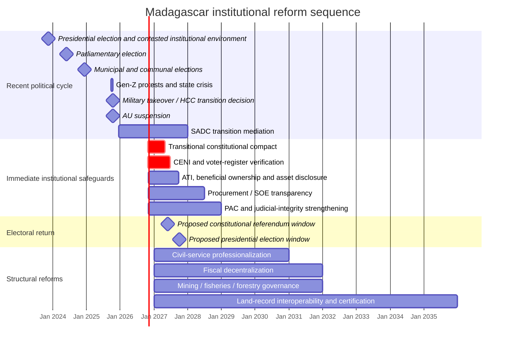
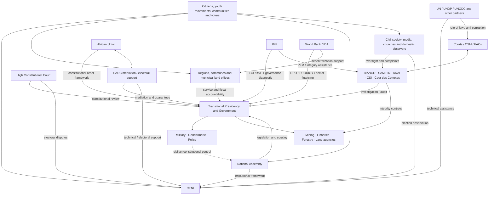

# Madagascar’s Institutional Reform Window After the 2025 Crisis

## Executive summary

Madagascar has entered its most consequential institutional-reform window since the transition that followed the 2009 political crisis. The immediate trigger was the September–October 2025 protest movement, initially driven by chronic electricity and water failures and then broadened to corruption, governance and living-standard grievances. President Andry Rajoelina left the country, the National Assembly moved against him, and Colonel Michaël Randrianirina and the CAPSAT military unit assumed power on 14 October 2025. The African Union classified the takeover as an unconstitutional change of government and immediately suspended Madagascar from AU activities; SADC, rather than disengaging, established a mediation and reform-support process centred on inclusive national dialogue, fresh elections and restoration of constitutional normalcy. citeturn19search0turn22view2turn25view2

The transition nevertheless has an unusual legal character. On 14 October 2025, Madagascar’s High Constitutional Court, or HCC, declared vacancies in the presidency and presidency of the Senate, entrusted the functions of head of state to Colonel Randrianirina, expressly prohibited dissolution of constitutional institutions during the vacancy and held that existing constitutional institutions and organs should continue exercising their normal powers. On 6 November the HCC further held that the presidential election could be postponed beyond the Constitution’s normal 30–60-day vacancy rule if political, security, financial and technical circumstances required it, subject to HCC supervision. That creates a **hybrid constitutional situation**: domestic legal institutions have supplied continuity rules for the transition, while the AU continues to regard the origin of the transition as unconstitutional. citeturn25view0turn25view1turn22view2

This distinction is central to reform design. Madagascar does **not** primarily need a wholesale replacement of institutions before elections. It needs to make the institutions that already exist harder to capture, more independent, more transparent and more capable of providing services. A constitution written mainly by current power holders could simply constitutionalize a new distribution of elite power. The preferable sequence is therefore **minimum constitutional settlement → integrity and electoral safeguards → credible referendum/election → deeper administrative and sectoral reform**. SADC’s December 2025 communiqué similarly called for a Malagasy-led inclusive dialogue, timely reforms, fresh elections and coordinated AU/SADC/international support; by August 2026 SADC was explicitly supporting inclusive governance, democratic institutions, accountability, human rights, citizen participation and return to constitutional normalcy. citeturn25view2turn25view3

The economic-policy environment creates a second reform window. The IMF approved parallel 36-month Extended Credit Facility and Resilience and Sustainability Facility programmes in June 2024, together initially worth roughly US$658 million. Following the political transition, the IMF did not abandon engagement: on 30 September 2026 it completed the combined third and fourth reviews and authorized about US$155 million in immediate disbursements. It explicitly urged rapid adoption and implementation of a Malagasy-owned action plan responding to its 2026 Governance Diagnostic and complementing the National Anti-Corruption Strategy 2025–2030. citeturn2search1turn22view4turn22view5

The World Bank provides a parallel implementation platform. Its second Equitable and Resilient Growth Development Policy Operation, approved in June 2025 for US$100 million, supports reforms in public financial management, decentralization, energy and mining. Its programme design already envisages e-procurement using the Open Contracting Data Standard, beneficial-ownership disclosure for large contracts, strengthened public-investment management, improved intergovernmental transfers and stronger JIRAMA governance. The PRODIGY digital-governance project additionally includes a biometric census of civil servants and information-technology governance for ministries. citeturn22view6turn14view1turn14view2turn14view3turn24search2

The most important finding of this report is therefore that **Madagascar already possesses most of the pieces of a viable institutional-reform programme**. The gap is implementation, independence, sequencing and political protection. The IMF diagnostic is unusually specific: it identifies fragmented anti-corruption institutions, incomplete anti-corruption courts, weaknesses in judicial independence, obstacles to prosecuting senior officials and judges, insufficient tax/customs controls, weak audit arrangements and opaque extractive-sector governance. Its priority recommendations include an access-to-information law, public land-allocation data, operational beneficial-ownership registers, publication of senior officials’ asset declarations, disclosure of large procurements and direct awards, stronger SOE reporting, an integrated integrity-agency data platform and tighter gold-sector controls. citeturn22view5turn6view1turn6view2turn7view0turn7view3

**Recommended priorities are consequently:**

| Horizon | Highest-priority reforms | Strategic purpose |
|---|---|---|
| **Immediate to late 2027** | Transitional constitutional compact; electoral/CENI reform; voter-register rebuild; access-to-information and beneficial-ownership measures; procurement/SOE disclosure; complete anti-corruption courts; protect HCC and judicial independence; biometric payroll verification | Prevent the transition from becoming permanent; establish minimum trust before referendum/elections |
| **2027–2029** | Judicial/CSM reform; e-procurement and audit integration; fiscal decentralization; professional civil service; land-information modernization; mining/gold traceability; fisheries transparency and regional MCS cooperation | Convert political transition into durable administrative capacity |
| **2030 onward** | Entrench balanced constitutional government; deepen local fiscal autonomy; comprehensive land/cadastre coverage; integrated forestry/fisheries governance; long-run civil-service pay/career reform | Reduce structural state capture and centre–periphery inequality |

The highest-return near-term interventions are not necessarily the most expensive. Publishing procurement data, beneficial owners, asset declarations, land allocations and extractive contracts; completing the six planned anti-corruption poles; protecting judicial inspectors; and setting transparent CENI appointment and voter-list rules could have disproportionately large effects on accountability relative to their fiscal cost. The most politically difficult reforms are instead those that redistribute power: limits on presidential authority, independent judicial appointments, campaign-finance transparency, removal of discretionary mining/land allocations, meritocratic senior civil-service recruitment and predictable transfers to local governments. citeturn6view1turn7view0turn14view1turn10view0turn10view1

## Recent developments and institutional diagnosis

Madagascar entered the present crisis after an electoral cycle that had already exposed legitimacy problems. SADC’s observation mission to the November 2023 presidential election recorded stakeholder concerns about serious voter-register discrepancies, duplications and errors, exclusion of young people, the absence of a comprehensive national identity database, election financing, media fairness and the independence of institutions. SADC also found that most recommendations from its 2018 and 2019 observation missions had not been implemented. citeturn10view0turn10view1

Parliamentary elections followed on 29 May 2024. Final results gave Rajoelina’s IRMAR coalition 84 of 163 National Assembly seats, an outright majority; 50 seats went to independents and 22 to the main Firaisankina opposition platform. Twenty-six women were elected. Municipal and communal elections were then held on 11 December 2024, providing a recently renewed local-government layer immediately before the 2025 national crisis. citeturn16search2turn16search6turn16search10

The crisis that began on 25 September 2025 exposed the institutional consequences of poor service delivery. Water and electricity shortages became catalysts for broader protests over corruption, governance and economic hardship; sections of the security forces defected, Rajoelina left the country, and military leaders claimed authority on 14 October. The AU PSC condemned the seizure of power and suspended Madagascar until constitutional order is restored. citeturn19search0turn19search4turn22view2

There is, however, a critical difference between the military’s initial announcement and the subsequent domestic legal position. The military initially announced the suspension or dissolution of several institutions, but the HCC’s decision of the same day explicitly stated that the interim head of state could not dissolve constitutionally established institutions and that those institutions continued exercising their normal powers. The HCC remained active thereafter, interpreting the transition, reviewing legislation and preserving the legal mandates of institutions including CENI and the HCDDED. citeturn19search0turn25view0turn25view1

SADC subsequently chose sustained engagement. Its December 2025 summit requested inclusive national dialogue, a roadmap and periodic progress reports; deployed its Panel of Elders and Mediation Reference Group; asked Madagascar to address constitutional reform, electoral processes and rule of law; and instructed the SADC Secretariat to coordinate with the AU and international partners. In January 2026 SADC reported that electoral reform was a transition priority and that Parliament was then functioning unicamerally. The August 2026 summit reaffirmed support for Madagascar’s reform process and return to constitutional normalcy. citeturn25view2turn22view3turn25view3

A constitutional referendum has been discussed for 2027, alongside a presidential election later in 2027; CENI public reporting cited in May 2026 placed a referendum provisionally in June and a presidential election in October. These dates should be treated as **provisional rather than constitutionally guaranteed**, because the HCC has explicitly authorized postponement where necessary and the institutional design of the proposed Fifth Republic remains unsettled. citeturn1search2turn25view1

The immediate institutional landscape can therefore be summarized as follows.

| Area | Principal weakness | Recent evidence / reform anchor |
|---|---|---|
| Executive | Historically concentrated presidential power; now compounded by military-origin transitional authority | 2025 crisis and AU suspension; HCC-created interim arrangement citeturn22view2turn25view0 |
| Legislature | Weak counterweight when executive controls a majority; uncertain bicameral settlement during transition | IRMAR won 84/163 seats in 2024; SADC reported unicameral operation in January 2026 citeturn16search6turn22view3 |
| Judiciary | Institutional dependence, opaque appointments and disciplinary arrangements; political pressure | IMF diagnostic says constitutional/institutional structure does not provide sufficiently effective judicial independence and identifies pressure and appointment vulnerabilities citeturn7view0turn7view2 |
| PFM | Weak procurement transparency, SOE oversight, audit and investment management | IMF diagnostic and World Bank DPO reforms citeturn6view1turn14view1turn14view2 |
| Anti-corruption | Fragmented institutions, weak coordination and incomplete PAC network | IMF Governance Diagnostic; SNLCC 2025–2030 citeturn22view5turn3search3turn7view0 |
| Decentralization | Local mandates exceed financial/administrative capacity; unpredictable transfers | World Bank DPO targets transfer reform and digital payments to communes citeturn14view3 |
| Civil service | Political interference, incomplete personnel controls and uneven administrative capacity | PRODIGY biometric civil-service census and ministry digital-governance work citeturn24search2turn24search0 |
| Elections | Weak voter register, identity-system gaps, campaign/media weaknesses and institutional distrust | SADC 2023 observation; CENI framework preserved by HCC citeturn10view0turn10view1turn25view1 |
| Mining | Permit opacity, gold leakage, beneficial-ownership and community-benefit risks | 2023 Mining Code; EITI rules; IMF recommendations citeturn15search21turn15search0turn6view1turn6view2 |
| Fisheries | IUU fishing, licensing/enforcement transparency and monitoring capacity | Fisheries Code and FAO legal assessment; regional SADC MCS Centre created in 2026 citeturn23search2turn25view3 |
| Forestry | Fragmented authority, weak enforcement and protected-area governance | Recent research links institutional weaknesses to deforestation in Malagasy protected areas citeturn23search36turn23search7 |
| Land | Incomplete certification, conflicting state/local records and opaque large allocations | Decentralized certification experience; 2026 state-domain legislation; IMF land-data recommendation citeturn17search26turn21search12turn6view1 |
| Rule of law | Selective accountability and procedural barriers to prosecuting politically exposed actors | IMF reports HCJ/PAC and authorization bottlenecks citeturn7view0turn7view3 |

A particularly serious rule-of-law problem is the gap between institutional existence and effective enforcement. The IMF found that the anti-corruption architecture is complex and internally fragmented; that only three of six contemplated anti-corruption poles were functioning; that referrals involving senior officials encounter procedural obstacles; and that the High Court of Justice had not produced a prosecution decision since 2018 despite numerous referrals. It also identified restrictions affecting investigations of judges and weak coordination among BIANCO, SAMIFIN, ARAI, PACs and other integrity institutions. citeturn7view0turn7view1

Natural-resource governance magnifies these problems because resource rights convert administrative discretion directly into rents. Madagascar’s 2023 Mining Code, Law No. 2023-007, created a modernized legal framework and incorporated beneficial-ownership obligations; EITI reports that the implementing framework uses a five-per-cent beneficial-ownership threshold. Yet the IMF diagnostic still calls for an operational national beneficial-owner register, publication of extractive contracts, stronger gold-export controls and transparent disclosure of large land and mining allocations. citeturn15search21turn15search0turn6view1turn6view2

Land governance is closely connected. Madagascar’s long-running reform decentralized certification to municipal land offices, making legal recognition more accessible than traditional titling, and World Bank-supported programmes expanded certification substantially. A 2025 academic review nevertheless characterizes the Malagasy land reform as a long and difficult implementation process rather than a completed institutional transition. In August 2026 the HCC reviewed Law No. 2026-008 governing the private immovable and movable domain of the state, decentralized territorial collectivities and other public-law entities, creating an immediate opportunity to integrate state-domain records with municipal certification and public disclosure. citeturn17search26turn17search3turn21search12

Recent academic research reinforces the need for institutional rather than purely environmental solutions in forestry. A 2023 study explicitly links institutional weaknesses to deforestation drivers in Malagasy protected areas, while a 2025 analysis finds that protected-area outcomes vary with governance arrangements and geographic context. That evidence argues against a uniform enforcement-only model and for local co-management, transparent resource rights and livelihood-sensitive conservation. citeturn23search36turn23search7

The macroeconomic backdrop makes failure costly. At its September 2026 review the IMF estimated 2025 real growth at only 3.1 per cent and projected 3.8 per cent in 2026, while highlighting tropical cyclones, oil-price shocks, persistent power outages and water shortages. These are not merely economic constraints: the 2025 uprising demonstrated that failures of essential infrastructure can become direct triggers of regime instability. citeturn22view4turn19search4

## Reform opportunities and implementation design

The resource figures below are **analytical order-of-magnitude categories, not government or donor budgets**. “Low” means primarily legislation, technical assistance and information systems; “medium” adds significant staffing, nationwide training or digital infrastructure; “high” includes nationwide election operations, cadastral work, enforcement assets or sustained subnational financing. Where an official cost has not been published in the sources reviewed, it is explicitly treated as **unspecified**.

**Transitional constitutional compact and restoration of civilian constitutional rule.**  
**Rationale:** The most important immediate reform is to resolve the contradiction between military-origin political authority, HCC-based domestic continuity and AU suspension. A limited transitional compact should establish the powers and prohibitions of the transitional presidency, security forces, government, legislature, HCC and CENI; an immutable election deadline or tightly defined extension mechanism; transparency requirements; and restrictions on unilateral constitutional or electoral rule changes. The HCC has already ruled that constitutional institutions cannot simply be dissolved and must continue their normal functions, while SADC requires inclusive dialogue and restoration of constitutional normalcy. citeturn25view0turn25view1turn25view2turn25view3  
**Legal constraint:** The 2010 Constitution remains the operative reference in HCC decisions; any new Fifth Republic should therefore be adopted by a procedurally credible referendum rather than by transitional decree. The transition must also address AU norms on unconstitutional changes of government. citeturn25view0turn22view2  
**Stakeholders:** transitional presidency, National Assembly, HCC, CENI, security services, political parties, Gen-Z/civic movements, churches, HCDDED, civil society, local-government representatives, AU and SADC.  
**Implementation:** agree binding transitional principles; publish all transition decrees; establish a multi-party constitutional commission with independent legal secretariat; conduct consultations in Malagasy as well as French; release draft constitutional text, explanatory memorandum and fiscal/institutional impact analysis well before referendum; require HCC pre-review of referendum legislation.  
**Timeline:** immediate, approximately 3–9 months for the compact; constitutional drafting/referendum can follow during 2027.  
**Resources:** medium; official budget **unspecified**.  
**Risks:** transition actors may design rules to entrench themselves; consultations may become symbolic; constitutional drafting may delay elections. **Mitigation:** sunset clauses, external constitutional expertise, published meeting records, civil-society representation and a “minimum necessary change” principle before elections.  
**Partner role:** SADC/AU should provide political guarantees and mediation rather than draft the constitution; UN constitutional/electoral assistance could provide comparative technical expertise. SADC has explicitly requested coordinated international support to avoid fragmentation. citeturn25view2

**Electoral integrity, CENI independence and a verified national voter register.**  
**Rationale:** This is the most time-critical technical reform. SADC’s 2023 mission documented concerns about discrepancies, duplicated or erroneous voter records, excluded young voters, the absence of a comprehensive identity database, election financing and media fairness; it also found that many earlier recommendations were still outstanding. citeturn10view0turn10view1  
**Legal constraint:** CENI is governed by Law No. 2015-020, and the HCC held in November 2025 that the statutory mandate of its members survived the transition. Electoral-law changes must therefore respect institutional continuity and should not permit partisan replacement of commissioners immediately before voting. citeturn22view1turn25view1  
**Stakeholders:** CENI, HCC, Interior Ministry, civil registry/identity agencies, parties, media regulator, domestic observers such as SAFIDY, youth and women’s organizations, diaspora groups, SADC/AU observers.  
**Implementation:** conduct a transparent register audit; reconcile civil-registration and voter data with privacy safeguards; provide a public claims-and-objections period; publish polling-station voter totals; adopt transparent commissioner nomination criteria; regulate campaign accounts and donations; ensure state-media neutrality; establish rapid electoral-dispute procedures; run a full operational simulation before the referendum.  
**Timeline:** immediate through the 2027 electoral cycle; register verification should be substantially complete several months before the referendum.  
**Resources:** high because of nationwide registration, polling logistics and cybersecurity; official amount **unspecified**.  
**Risks:** contested deletions, digital exclusion, identity errors, partisan capture and cyber incidents. **Mitigation:** paper fallback, independent audit, public change logs, observation access and immutable cut-off dates.  
**Partner role:** SADC and AU election divisions, UNDP electoral support, and bilateral donors can supply logistics, cybersecurity, register auditing and observation, but CENI must remain the visible national owner. citeturn25view2turn25view3

**Judicial independence, prosecution integrity and completion of anti-corruption courts.**  
**Rationale:** Elections cannot compensate for a judiciary unable to review government action or prosecute elite corruption. The IMF diagnostic identifies political pressure, opaque appointments, deficiencies in discipline and inspection, procedural barriers to investigations, incomplete PAC coverage and weak institutional independence. citeturn7view0turn7view2  
**Legal constraint:** Some reforms can be enacted by ordinary/organic law, but deeper independence questions—including the constitutional status and composition of judicial-governance bodies—may require constitutional amendment. The existing constitutional framework and judicial tenure guarantees must remain operative until valid amendment.  
**Stakeholders:** Supreme Court, HCC, Conseil Supérieur de la Magistrature, Ministry of Justice, judicial inspectorate/BCCJEP, PACs, BIANCO, bar associations and civil society.  
**Implementation:** complete and staff all six PACs; give the judicial inspectorate adequate budget and direct institutional access; publish reasoned disciplinary decisions with privacy safeguards; establish transparent appointment and promotion criteria; remove unnecessary executive authorization barriers to corruption investigations; institute case-tracking and random case assignment; expand continuous legal training. These measures closely track the IMF diagnostic. citeturn7view1turn7view2  
**Timeline:** 6–24 months for PAC and inspection reforms; 2–4 years for constitutional judicial restructuring.  
**Resources:** medium; salaries, secure court infrastructure, case-management systems and investigators are required; official cost **unspecified**.  
**Risks:** judicial reforms can become mechanisms for purging opponents. **Mitigation:** prospective rules, transparent selection panels, review rights, publication of anonymized case-flow statistics and externally observed appointment procedures.  
**Partner role:** IMF technical assistance on governance; UNODC on judicial integrity; AU/SADC peer institutions and development partners on court digitization and training. citeturn22view5

**Anti-corruption architecture, access to information and beneficial ownership.**  
**Rationale:** Madagascar does not primarily lack anti-corruption bodies; it lacks interoperability, autonomy, disclosure and consistent enforcement. Its National Anti-Corruption Strategy 2025–2030 supplies a current policy framework, while the IMF identifies fragmented responsibilities among BIANCO, SAMIFIN, ARAI, PACs and other institutions. citeturn3search3turn22view5turn7view0  
**Legal constraint:** an access-to-information statute, revised asset-declaration rules and beneficial-ownership regulations must reconcile transparency with privacy and due-process guarantees. Institutional mandates should be rationalized rather than duplicated.  
**Stakeholders:** BIANCO, CSI, SAMIFIN, ARAI, PACs, HCC, Cour des Comptes, Ministry of Finance, company registry, mining ministry, media and NGOs.  
**Implementation:** adopt access-to-information legislation; create an operational beneficial-owner register; publish legally required senior-official asset declarations; establish a secure shared integrity-agency platform; give the Cour des Comptes appropriate access; create an independent recommendation process for BIANCO leadership appointments; publish annual referral/prosecution/recovery statistics. These are among the IMF’s explicit priority recommendations. citeturn6view1turn6view2turn7view1  
**Timeline:** most disclosure reforms are feasible within 6–18 months; full data interoperability 18–30 months.  
**Resources:** low-to-medium; official amount **unspecified**.  
**Risks:** inaccurate beneficial-owner data, weaponized asset disclosures and non-compliance by politically connected actors. **Mitigation:** verification against tax/company/banking data, sanctions for false filing, independent appeals and risk-based verification.  
**Partner role:** IMF, World Bank, UNODC and EITI can align technical assistance; the existing EITI–SAMIFIN cooperation on beneficial ownership offers a sectoral starting point. citeturn15search15turn15search0

**Public financial management, procurement and state-owned enterprises.**  
**Rationale:** Weak procurement, investment management and SOE oversight translate institutional capture directly into fiscal losses and poor services. The World Bank DPO identified weak accountability in procurement, public investment and SOEs; it supports an independent procurement dispute mechanism and an e-procurement system using the Open Contracting Data Standard in high-spending ministries. citeturn14view0turn14view1turn14view2  
**Legal constraint:** procurement reforms can largely proceed under ordinary legislation and regulations; publication rules must nevertheless cover emergency and direct awards, which often escape normal competition. SOE governance must respect company law while requiring public-interest disclosure.  
**Stakeholders:** Ministry of Economy and Finance, procurement regulator, Treasury, Cour des Comptes, line ministries, JIRAMA, other major SOEs, parliament and suppliers.  
**Implementation:** deploy end-to-end e-procurement; publish award and beneficial-owner data; disclose the ten largest procurements and major direct awards; strengthen commitment controls and public-investment appraisal; publish audited SOE statements and auditor opinions; create a consolidated fiscal-risk statement; ensure timely follow-up on audit recommendations. The IMF separately recommends publication of major procurement and SOE information. citeturn6view1turn14view1  
**Timeline:** 6–24 months for disclosure/e-procurement; 2–4 years for mature SOE and investment-risk management.  
**Resources:** medium, with substantial recurrent value once systems are operational; official amount **unspecified**.  
**Risks:** shifting corruption from paper procurement to specifications, contract amendments or subcontracting. **Mitigation:** publish tender documents, amendments, implementation milestones and beneficial owners across the full contracting chain.  
**Partner role:** World Bank DPO/technical assistance is the obvious anchor; IMF can support fiscal reporting and control architecture. The World Bank’s US$100-million 2025 DPO already provides policy leverage. citeturn22view6turn22view4

**Fiscal decentralization and accountable local government.**  
**Rationale:** Madagascar’s highly centralized administration leaves communes responsible for services without sufficiently predictable finance or administrative capacity. Weak local institutions also undermine land management, disaster resilience and citizen trust. The World Bank’s current DPO targets a more equitable transfer formula, digital Treasury payments and improved transfer timeliness; its programme envisages e-wallet/Treasury access for 200 communes and improved delivery of local fiscal transfers by 2027. citeturn14view3  
**Legal constraint:** constitutional recognition of decentralized territorial collectivities means reform should strengthen, not bypass, elected local government. Revenue assignments and transfer formulas require legislation and predictable budget appropriations.  
**Stakeholders:** Ministry of Interior/decentralization, Ministry of Finance, regions, communes, mayors, municipal councils, local land offices, service ministries and community organizations.  
**Implementation:** enact a transparent formula combining population, poverty, remoteness and service needs; publish commune allocations and payment dates; expand Treasury digital-payment access; require simple local budgets and procurement disclosure; create performance grants without penalizing structurally poor communes; strengthen local audit and participatory planning.  
**Timeline:** formula and disclosure reforms within 12 months; administrative capacity 2–5 years.  
**Resources:** medium-to-high because meaningful decentralization ultimately requires larger recurrent intergovernmental transfers; precise envelope **unspecified**.  
**Risks:** decentralizing corruption, elite capture and uneven capacity. **Mitigation:** fiscal transparency, standardized accounting, social audits, minimum-capacity grants and risk-based external audit.  
**Partner role:** World Bank already has the strongest policy platform; UNDP and bilateral partners can support participatory governance and local administrative capacity. citeturn14view3turn24search6

**Professional civil service and verified payroll.**  
**Rationale:** Administrative reform will fail if appointments remain politicized or the state cannot reliably identify, deploy and manage its personnel. The World Bank’s PRODIGY project includes a biometric census for civil servants, including teachers, and ministry IT-governance measures, creating a concrete foundation for a unified personnel registry. citeturn24search2  
**Legal constraint:** existing civil-service tenure and labour rights constrain abrupt dismissals; biometric processing requires privacy, security and appeal safeguards. Reform should distinguish fraudulent/duplicate records from legitimate employees whose data are incomplete.  
**Stakeholders:** civil-service ministry, Finance/Treasury, line ministries, unions, data-protection authorities, teachers and health-worker organizations.  
**Implementation:** complete the biometric census; reconcile payroll, position establishment and personnel files; freeze creation of unbudgeted posts; establish merit-based competitive recruitment for senior administrative positions; introduce transparent transfer/promotion criteria; create a skills inventory and continuing-training system; gradually harmonize fragmented allowances.  
**Timeline:** payroll verification 6–18 months; merit and career reform 2–5 years.  
**Resources:** medium; official programme-level incremental cost **unspecified**.  
**Risks:** biometric exclusion, politically selective deletion, union resistance and loss of scarce skilled staff. **Mitigation:** independent grievance procedures, staged verification, audit trails, role-based access controls and no automatic dismissal solely because of a data mismatch.  
**Partner role:** World Bank/PRODIGY should remain the digital backbone; donors should avoid building parallel personnel databases. citeturn24search2turn24search6

**Mining, gold and extractive-sector integrity.**  
**Rationale:** Madagascar’s mineral endowment can finance development, but discretionary permits, opaque ownership and informal gold exports create exceptionally high capture risk. Law No. 2023-007 modernized the Mining Code, and EITI reports that the new framework includes beneficial-ownership requirements; the IMF nevertheless identifies extractive transparency and gold control as urgent governance weaknesses. citeturn15search21turn15search0turn6view1turn6view2  
**Legal constraint:** reforms must respect existing permits and contractual rights while applying prospective disclosure, environmental and community-benefit requirements. Expropriating lawful licences without due process would generate litigation and deter legitimate investors.  
**Stakeholders:** mines ministry, mining cadastre, Finance/customs, EITI multi-stakeholder group, SAMIFIN, BIANCO, companies, artisanal miners, affected communes and communities.  
**Implementation:** publish the mining cadastre and permit history; link licences to verified beneficial owners; disclose contracts and fiscal terms; audit physical gold production/export flows against customs declarations; license and trace approved gold exporters; publish community-development agreements and local revenue transfers; use risk-based inspection rather than discretionary enforcement.  
**Timeline:** transparency and gold-audit measures 6–18 months; formalization and community benefit systems 2–4 years.  
**Resources:** medium. Gold assaying, digital cadastre and customs systems require investment; official amount **unspecified**.  
**Risks:** informal production moving further underground, smuggling and capture of formalization by intermediaries. **Mitigation:** accessible licensing for artisanal miners, competitive legal buying channels, traceability and targeted enforcement against networks rather than subsistence miners.  
**Partner role:** EITI, IMF and World Bank can harmonize ownership, fiscal and mining-cadastre standards; civil society should sit within the multi-stakeholder oversight architecture. citeturn15search0turn7view1

**Fisheries and forestry transparency with community co-governance.**  
**Rationale:** Fisheries and forests suffer from a similar institutional problem: valuable resources are geographically remote from central regulators, while licensing, enforcement and community rights intersect. FAO’s assessment of Madagascar’s fisheries framework recognizes legal mechanisms for sustainable management and enforcement, yet compliance and transparency remain critical. Recent research on forests links weak institutions to deforestation in protected areas. citeturn23search2turn23search36turn23search7  
**Legal constraint:** fisheries licensing and monitoring must operate under the Fisheries and Aquaculture Code; forestry reform must reconcile protected areas, community management rights and national environmental law. Existing community rights should not be extinguished through conservation reclassification without due process.  
**Stakeholders:** fisheries and environment ministries, Fisheries Surveillance Centre, forest/park authorities, coast guard/security services, local communities, small-scale fishers, industrial vessels, conservation NGOs and regional bodies.  
**Implementation:** publish fishing licences, access agreements, vessel identity and beneficial ownership; require vessel monitoring where technically appropriate; publish enforcement statistics; use the new SADC Regional Fisheries Monitoring, Control and Surveillance Coordination Centre for cross-border intelligence; in forests, disclose concessions and sanctions, strengthen community management contracts, use satellite monitoring with ground verification and link enforcement to alternative livelihoods. SADC inaugurated its regional MCS centre in Maputo in June 2026. citeturn25view3turn15search19  
**Timeline:** transparency measures 6–18 months; surveillance and community-governance reforms 2–5 years.  
**Resources:** medium-to-high, particularly for patrol assets, satellite/data systems and community programmes; official amount **unspecified**.  
**Risks:** criminalization of poor resource users while politically connected operators remain untouched. **Mitigation:** publish enforcement by actor type, independent complaint mechanisms, proportional sanctions and livelihood transition programmes.  
**Partner role:** SADC MCS coordination, FAO technical assistance and conservation partners can support implementation, while government retains licensing authority. citeturn25view3turn23search2

**Land tenure, state-land transparency and local dispute resolution.**  
**Rationale:** Madagascar’s decentralized certification model dramatically lowered the institutional distance between rural citizens and land administration, but coverage and interoperability remain incomplete. The IMF now recommends a consolidated public database of large state land allocations—specifically including allocations above 2,500 hectares, mining/petroleum permits, beneficiaries, environmental assessments and project status. citeturn17search26turn6view1  
**Legal constraint:** Article 34 of the Constitution recognizes state responsibility to facilitate access to land ownership through appropriate legal arrangements and transparent land information. New Law No. 2026-008 concerning the private property domain of the state and decentralized authorities creates an opportunity, but its practical regulations and implementation costs are **unspecified** in the material reviewed. citeturn16search9turn21search12  
**Stakeholders:** land ministry, communes and municipal land offices, courts, surveyors, agriculture/environment/mining ministries, customary users, women’s groups and investors.  
**Implementation:** digitize and reconcile state titles and communal certificates; publish large land allocations; establish a parcel-level dispute/overlap flag; preserve low-cost local certification; simplify transfers and inheritance; explicitly enable joint spousal registration; create district-level mediation before litigation; integrate mining/forest/environmental layers into land-information systems.  
**Timeline:** disclosure and pilot interoperability 12–24 months; nationwide cadastre/certification 5–10 years.  
**Resources:** high because nationwide surveying, digitization and local-office staffing are expensive; official national cost **unspecified**.  
**Risks:** digitizing erroneous or captured claims can make injustice more durable; cadastral modernization can accelerate land concentration. **Mitigation:** public objection periods, historical-record reconciliation, community mapping, gender safeguards and an independent appeals mechanism. Recent scholarship on Malagasy land reform supports treating certification as an ongoing institutional process rather than merely a mapping exercise. citeturn17search3turn23search17

## Prioritization and comparative assessment

The reforms are ranked against five criteria: **institutional impact**—how much the reform changes incentives and accountability across government; **urgency**—especially whether it must precede the 2027 referendum/election cycle; **technical feasibility**—whether the legal and administrative instruments already exist; **political feasibility**—whether powerful actors must surrender discretion or rents; and **dependency value**—whether the reform enables several other reforms. Scores below are analytical assessments, not externally published indicators.

“Cost” represents public-sector and partner implementation burden, not the economic cost of reform. For example, beneficial-ownership disclosure is relatively cheap administratively but politically difficult; nationwide land modernization is both institutionally and fiscally expensive.

| Reform option | Impact | Technical feasibility | Cost | Realistic first-results timeline | Political acceptability | Overall priority |
|---|---:|---:|---|---|---:|---|
| Transitional constitutional compact / civilian restoration | **5/5** | 4/5 | Low–medium | 3–9 months | 2/5 | **Critical** |
| Electoral/CENI and voter-register integrity | **5/5** | 4/5 | High | 6–12 months | 3/5 | **Critical** |
| Judicial independence and complete PAC network | **5/5** | 3/5 | Medium | 12–36 months | 2/5 | **Very high** |
| Anti-corruption disclosure, ATI and beneficial ownership | **5/5** | **5/5** | Low–medium | 6–18 months | 2/5 | **Very high** |
| PFM, open procurement and SOE accountability | **5/5** | **5/5** | Medium | 6–24 months | 3/5 | **Very high** |
| Fiscal decentralization / commune capability | 4/5 | 4/5 | Medium–high | 12–36 months | 3/5 | **High** |
| Civil-service payroll and merit reform | 4/5 | 4/5 | Medium | 6–36 months | 3/5 | **High** |
| Mining/gold/EITI integrity | 4/5 | **5/5** | Medium | 6–24 months | 2/5 | **High** |
| Fisheries/forestry governance | 4/5 | 3/5 | Medium–high | 12–48 months | 3/5 | Medium–high |
| Land/cadastre and state-land transparency | **5/5** | 3/5 | **High** | 12 months–10 years | 2/5 | High, long-horizon |

The principal prioritization implication is that the reform agenda should **front-load measures that make the transition itself more contestable and observable**. Access to information, procurement disclosure, beneficial-ownership reporting, CENI safeguards and judicial protections should not wait for a Fifth Republic. Most are implementable within the current legal framework and are already supported by the IMF/World Bank reform architecture. citeturn6view1turn14view1turn22view5

Conversely, reforms whose legitimacy depends upon a durable constitutional settlement—such as the final structure of the presidency, bicameralism, the constitutional status of judicial governance bodies or fundamental changes to territorial government—should be designed now but entrenched only through an inclusive and legitimate constitutional process. The present transition should not use “institutional reform” as a rationale for concentrating powers that a subsequent elected government would find difficult to reverse. That sequencing is consistent with the HCC’s insistence on institutional continuity and SADC’s emphasis on inclusive, Malagasy-led reform. citeturn25view0turn25view2

**Short term — now through the 2027 return-to-electoral-rule window.** The first tier should comprise a binding transition compact; verified voter register and CENI protections; access-to-information legislation; beneficial-owner and asset-declaration publication; open procurement/direct-award disclosure; complete PAC staffing; protection of judicial inspection; biometric payroll reconciliation; and basic mining/gold transparency. These measures address both the proximate legitimacy crisis and recommendations already embedded in IMF/World Bank programmes. citeturn22view4turn6view1turn14view1turn24search2

**Medium term — roughly 2027–2029.** Priorities should shift toward judicial-governance reform, mature e-procurement, SOE fiscal-risk management, merit-based senior civil-service recruitment, predictable formula-based commune transfers, fully linked integrity-agency databases, land-record interoperability, formalization of artisanal mining and strengthened fisheries monitoring. citeturn7view1turn14view3turn15search0turn25view3

**Long term — 2030 and beyond.** The agenda should deepen decentralized fiscal autonomy, professional civil-service careers, nationwide land certification/cadastre coverage, local courts and dispute resolution, community-centred forest governance, sustainable fisheries institutions and constitutional consolidation based on evidence from the first post-transition electoral cycle. These are reforms requiring sustained financing and institutional learning rather than one-off legislation. citeturn17search3turn23search36turn23search2

## Reform sequencing and transition timeline

Recent events suggest that institutional sequencing matters as much as institutional design. The 2025 uprising began with failures in basic service delivery but escalated into a constitutional crisis; the lesson is that electricity, water, fiscal governance and democratic legitimacy cannot be separated analytically. IMF programme documents in September 2026 explicitly connect the political transition with continuing electricity/water shortages and climate shocks. citeturn19search4turn22view4

The June and October 2027 markers above represent **provisional announced windows, not guaranteed dates**. CENI reporting cited in May 2026 contemplated a June constitutional referendum and October presidential election, while the HCC’s November 2025 interpretation allows postponement where objective political, security, financial or technical conditions prevent a credible election. citeturn1search2turn25view1

A viable reform programme should therefore use explicit **decision gates**. Before any constitutional referendum, there should be an audited voter register, effective CENI operating independence, publication of the proposed text with enough time for public deliberation, functioning election-dispute mechanisms and a transparent campaign environment. Before the presidential election, the government should additionally demonstrate that security forces are politically neutral, campaign-finance rules are enforced and domestic/international observers have unrestricted access. These are analytic recommendations grounded in the shortcomings identified by SADC’s previous election observation and the institutional risks created by the 2025 transition. citeturn10view0turn10view1turn25view2

The stakeholder architecture should make national institutions primary, regional organizations guarantors, and international financial institutions financiers and technical partners—not substitute governments.

The dotted civil-military line in that diagram is intentionally important: Madagascar’s transition will not be institutionally complete merely when an election occurs. Durable normalization requires the security sector to return to an unambiguous, legally bounded and politically neutral role under civilian constitutional authority. The AU’s suspension decision and SADC’s repeated emphasis on constitutional normalcy make this an essential outcome rather than a secondary security-sector issue. citeturn22view2turn25view3

## Political economy, risks and partner strategy

The central political-economy risk is **reform capture**: actors who control transition institutions can support “reform” while redesigning rules to preserve their own influence. This is particularly acute in constitutional drafting, judicial appointments, mining permits, public procurement and appointments to autonomous agencies. A 2026 Governance & Integrity Anti-Corruption Evidence analysis describes Madagascar’s underlying challenge as a cycle of state capture in which political and economic networks can monopolize opportunities and bend state institutions toward private interests. That interpretation is consistent with the more granular vulnerabilities identified independently in the IMF Governance Diagnostic. citeturn23search16turn22view5

A second risk is **overloading the transition**. Trying simultaneously to redesign the Constitution, judiciary, civil service, territorial state, land system and resource sectors before elections would produce delay and increase discretion. The transition should instead adopt irreversible transparency measures and minimum democratic safeguards while leaving complex structural redesign to elected institutions. The distinction is important: disclosure of contracts or procurement data does not prejudge the political programme of a future government, whereas restructuring the entire legislature or judicial hierarchy does. citeturn6view1turn25view2

A third risk is **formal compliance without enforcement**. Madagascar already has BIANCO, SAMIFIN, PACs, EITI processes, procurement rules and constitutional oversight institutions. The IMF’s findings show why institution creation alone is insufficient: coordination failures, procedural barriers, incomplete territorial coverage and weak follow-through allow nominally strong frameworks to coexist with impunity. Donors should therefore measure outcomes—cases resolved, data published, procurement competition, audit findings implemented—not laws passed or workshops held. citeturn7view0turn7view1turn7view3

A fourth risk is **capital-centric reform**. Judicial, civil-society, land, audit and anti-corruption capabilities are weaker outside Antananarivo. The IMF explicitly notes reduced resources and controls away from the capital, while World Bank decentralization work identifies the need for more responsive transfers to vulnerable communes. Reform financing should therefore include recurrent subnational staffing and connectivity rather than only central information systems. citeturn7view0turn24search6

A fifth risk is **digitizing bad governance**. Biometric payrolls, e-procurement, cadastral databases and beneficial-owner registries can reduce discretion, but digitalization can also make erroneous records, exclusion or opaque automated decisions more durable. Every digital reform should therefore combine identity verification with appeal rights, immutable audit logs, role-based access, public non-sensitive datasets, cybersecurity standards and offline procedures for citizens lacking connectivity. The existing PRODIGY civil-service census and World Bank e-procurement agenda make these safeguards immediately relevant. citeturn24search2turn14view1

Donor coordination should follow the comparative advantages already visible in Madagascar:

| Partner | Highest-value role | What it should avoid |
|---|---|---|
| **SADC** | Political mediation; transition guarantees; electoral standards; security-sector dialogue; fisheries MCS cooperation | Treating technical assistance as a substitute for political settlement |
| **African Union** | Normative framework for restoration of constitutional order; election legitimacy and continental peer pressure | Inconsistent application of anti-coup norms |
| **IMF** | PFM, tax/customs integrity, governance diagnostic, anti-corruption architecture, macro-fiscal conditionality | Turning highly political governance questions into narrow checklist compliance |
| **World Bank/IDA** | E-procurement, decentralization, GovTech/PRODIGY, SOE reform, energy, mining and land systems | Parallel databases or project structures that weaken permanent institutions |
| **UNDP/UNODC/UN system** | Elections, constitutional process, access to justice, anti-corruption and institutional capacity | Donor-driven constitutional design |
| **EITI and sector partners** | Extractive beneficial ownership, contract/revenue disclosure and multi-stakeholder oversight | Treating disclosure as sufficient without enforcement |
| **Civil society / academia / media** | Independent monitoring, citizen information, policy evaluation and social accountability | Becoming dependent on executive-controlled funding |

This division of labour is strongly supported by existing commitments. SADC has expressly asked its Secretariat to coordinate with the AU and international partners to mobilize technical, financial and logistical resources and avoid fragmentation. The IMF is already tying programme advice to a Malagasy-owned governance-diagnostic action plan. The World Bank is financing complementary fiscal, digital, mining and energy reforms rather than a standalone generic “governance” project. citeturn25view2turn22view4turn22view6

A compact monitoring framework should publish quarterly indicators in Malagasy and French. The most useful measures would include voter-register challenges and corrections; CENI decisions and procurement; proportion of public contracts disclosed in open data; percentage of competitive versus direct awards; audited SOE financial statements published; PAC case stock and disposition time; BIANCO-to-prosecution referral outcomes; asset declarations published; beneficial owners verified; commune transfers paid on time; payroll records reconciled; mining licences and contracts publicly searchable; official versus estimated gold exports; fishing licences/vessel ownership published; land certificates issued and disputes resolved; and implementation status of Cour des Comptes recommendations. These indicators correspond directly to weaknesses and reforms identified by the IMF and World Bank. citeturn6view1turn6view2turn14view1turn14view3

The key strategic judgement is that **Madagascar should treat the 2025 crisis as a warning against both personalized civilian rule and open-ended military tutelage**. The 2010 constitutional framework did not prevent institutional capture or service failure, but replacing it without fixing administrative integrity would solve little. The strongest reform package is therefore one that constrains whoever wins power next: an independently administered electoral system; courts able to rule against government; transparent public money and resource rights; a professional civil service; empowered local institutions; and automatic disclosure systems that make capture harder to conceal. The political transition makes these reforms difficult, but it also makes their purpose unusually clear. citeturn22view2turn22view5turn25view3

## Key sources and URLs

The research prioritized official Malagasy institutions, the IMF, World Bank, AU, SADC, international standard-setting organizations and recent academic/policy research. Several official documents are in French; substantive points above are paraphrased rather than quoted.

**Malagasy constitutional and electoral institutions**

High Constitutional Court, Decision No. 10-HCC/D3, 14 October 2025 — transition and presidential vacancy:  
https://www.hcc.gov.mg/?p=9647 citeturn25view0

High Constitutional Court, Decision No. 13-HCC/D3, 6 November 2025 — continuity of institutions and election postponement:  
https://www.hcc.gov.mg/?p=9688 citeturn25view1

High Constitutional Court, Decision on Law No. 2026-008 concerning state and decentralized-authority property:  
https://www.hcc.gov.mg/?p=10057 citeturn21search12

CENI, provisional results of communal and municipal elections of 11 December 2024:  
https://www.ceni-madagascar.mg/resultats-provisoires-des-elections-communales-et-municipales-du-11-decembre-2024/ citeturn16search10

**African Union and SADC**

African Union Peace and Security Council, 1306th meeting communiqué, 15 October 2025:  
https://www.peaceau.org/en/article/communique-of-the-1306th-meeting-of-the-psc-emergency-session-held-on-15-october-2025-on-updated-briefing-on-the-situation-in-the-republic-of-madagascar citeturn22view2

SADC Extraordinary Summit communiqué, 17 December 2025:  
https://www.sadc.int/latest-news/communique-extraordinary-summit-sadc-heads-state-and-government-17th-december-2025 citeturn25view2

SADC Executive Secretary engagement with Madagascar, 24 January 2026:  
https://www.sadc.int/latest-news/sadc-executive-secretary-engages-leadership-madagascar-and-seychelles-regional citeturn22view3

SADC 46th Ordinary Summit communiqué, 17 August 2026:  
https://www.sadc.int/latest-news/communique-46th-ordinary-summit-sadc-heads-state-and-government-17th-august-2026 citeturn25view3

**International Monetary Fund**

IMF approval of ECF and RSF arrangements, June 2024:  
https://www.imf.org/en/news/articles/2024/06/21/pr-24232-madagascar-imf-approves-us-337-million-under-the-ecf-and-us-321-million-under-the-rsf citeturn2search1

IMF second reviews under ECF/RSF, 3 July 2025:  
https://www.imf.org/en/news/articles/2025/07/03/pr-25239-madagascar-imf-completes-2nd-rev-under-ecf-and-rsf-arrang citeturn2search3

IMF Governance Diagnostic, 8 May 2026:  
https://www.imf.org/en/publications/technical-assistance-reports/issues/2026/05/08/republic-of-madagascar-technical-assistance-report-assessment-of-governance-and-575936 citeturn22view5

IMF combined third and fourth ECF/RSF reviews, 30 September 2026:  
https://www.imf.org/en/news/articles/2026/09/30/pr26312-republic-of-madagascar citeturn22view4

**World Bank**

World Bank, Second Equitable and Resilient Growth DPO, June 2025:  
https://www.worldbank.org/en/news/press-release/2025/06/18/madagascar-leveling-the-playing-field-for-equitable-and-resilient-growth-across-key-sectors citeturn22view6

World Bank DPO programme document, including procurement, decentralization, SOE and mining reforms:  
https://documents1.worldbank.org/curated/en/099052825141069158/pdf/BOSIB-09968310-4a5e-49e2-8770-1d32ff1c411e.pdf citeturn14view1turn14view2turn14view3

World Bank, Madagascar land-reform results:  
https://www.worldbank.org/en/results/2023/11/19/madagascar-making-an-impact-on-land-reform-and-agriculture citeturn12search2

FAO/World Bank land-certification results story, February 2025:  
https://www.fao.org/newsroom/story/a-more-secure-future-from-a-single-document/en citeturn17search26

**Anti-corruption, extractives and legislation**

BIANCO, National Anti-Corruption Strategy 2025–2030:  
https://www.bianco-mg.org/fr/actuality/41-madagascar-adopte-une-nouvelle-strategie-nationale-de-lutte-contre-la-corruption citeturn3search3

Transparency International, Madagascar country profile:  
https://www.transparency.org/en/countries/madagascar citeturn3search6

EITI, Madagascar country page:  
https://eiti.org/countries/madagascar citeturn15search0

SAMIFIN–EITI Madagascar beneficial-ownership cooperation:  
https://www.samifin.gov.mg/mou-eiti-madagascar citeturn15search15

ILO NATLEX, Law No. 2023-007 reforming the Mining Code:  
https://natlex.ilo.org/dyn/natlex2/r/natlex/fe/details?p3_isn=117358 citeturn15search21

**Recent research and sectoral analysis**

Burnod et al., *The long and winding road of the land reform in Madagascar*, 2025:  
https://www.sciencedirect.com/science/article/abs/pii/S0264837725002455 citeturn17search3

Rasoamanana, Roland and Gardner, *Linking Institutional Weaknesses to Deforestation Drivers in the Governance of Protected Areas in Madagascar*, 2023:  
https://www.taylorfrancis.com/chapters/oa-edit/10.4324/9781003363101-10/linking-institutional-weaknesses-deforestation-drivers-governance-protected-areas-madagascar-alexandra-rasoamanana-roland-fr%C3%A9d%C3%A9ric-tahina-charlie-gardner citeturn23search36

Andrianambinina et al., *Complex Deforestation Patterns in and Around the Protected Areas of Madagascar*, 2025:  
https://www.mdpi.com/2073-445X/14/4/698 citeturn23search7

FAO, legal assessment of the ecosystem approach to fisheries in Madagascar:  
https://openknowledge.fao.org/bitstreams/2352ab4d-5a11-4bff-981e-98daabfe13b0/download citeturn23search2

Governance & Integrity Anti-Corruption Evidence, *Madagascar at a crossroads: breaking the cycle of state capture*, 2026:  
https://giace.org/resources/madagascar-at-a-crossroads/ citeturn23search16

Reuters, chronology of the October 2025 takeover and preceding protests:  
https://www.reuters.com/world/asia-pacific/madagascars-president-dissolves-national-assembly-escalating-crisis-2025-10-14/ citeturn19search0